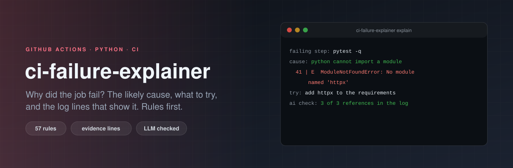

<p align="center">
  
</p>

# ci-failure-explainer

[](https://github.com/ErenOzgu/ci-failure-explainer/actions/workflows/ci.yml)


[](LICENSE)

A red build tells you *that* something failed. The answer to *why* is usually 800 lines up in a log. This tool reads the log of the failed job, finds the step that failed, and writes a short explanation: the most likely cause, what to try, and the log lines that show it.

**Rules do the work, a model is optional.** 57 rules cover the failures that account for most red builds (a missing module, a full disk, a token without permission, a lock file out of sync, a rate limit...). They run offline, are free, give the same answer every time, and say which log lines they used. If you want a model's reading on top, `--llm` adds it, and then **every file name, test and tool code in the answer is looked up in the log**; the ones that are not there are listed, because a plausible file name that does not exist is how a wrong explanation becomes believable.

## Use it in a workflow

Add a job that runs after the others and explains whatever failed:

```yaml
jobs:
  build:
    runs-on: ubuntu-latest
    steps:
      - uses: actions/checkout@v4
      - run: make test

  explain-failures:
    needs: [build]
    if: failure()                  # only when something failed
    runs-on: ubuntu-latest
    permissions:
      actions: read                # to read the logs of this run
    steps:
      - uses: ErenOzgu/ci-failure-explainer@v0.1.0
```

The explanation appears on the run's summary page. The action also has outputs (`failed-jobs`, `causes`, `report-path`) and inputs to pick jobs (`include-jobs`, `exclude-jobs`), add your own rules (`rules`), and turn on the model (`llm`, `anthropic-api-key`, `strict-llm`). It needs `python3` 3.11 or newer on the runner; `ubuntu-latest` has it.

A report looks like this. It is the real one from this repo's own CI run, in which one job fails on purpose and the next job runs the action on it (the log is a few hundred lines; the report names the failing test and the line that shows it):

````markdown
## Why `Planted failure (on purpose)` failed
conclusion: **failure** · failed step: `Run the test that fails on purpose` · command: `python -m pytest examples/planted -q` · [job log](...)

### Most likely cause: Tests failed

A test assertion failed (first: `examples/planted/test_orders.py::test_total_discount`, assert 100 == 90). The failure section above the summary shows the values that were compared.

What to try:

1. Reproduce with `pytest examples/planted/test_orders.py::test_total_discount`.
2. If it only fails in CI, compare Python and dependency versions, the locale and time zone, the working directory and the environment variables.

Evidence (log lines 172 to 174):

```text
  172 | =========================== short test summary info ============================
  173 | FAILED examples/planted/test_orders.py::test_total_discount - assert 100 == 90
  174 |  +  where 100 = total([5, 95], discount=0.1)
```

Also in the log: A command exited with a non-zero status (`exit-code`)
````

## Use it from the command line

```sh
pip install git+https://github.com/ErenOzgu/ci-failure-explainer

# a run, through the API (the token needs to read Actions logs of the repository)
GITHUB_TOKEN=... ci-failure-explainer explain --repo owner/name --run-id 123456789

# a log you downloaded (or piped in with --log -)
ci-failure-explainer explain --log job.log

ci-failure-explainer explain --log job.log --format json     # for scripts
ci-failure-explainer explain --log job.log --rules mine.toml # your own rules
ci-failure-explainer rules                                    # list the built-in ones
```

`--job TEXT` and `--exclude-job TEXT` pick jobs by name. Failed jobs are explained; jobs that were only *cancelled* (the other cells of a matrix after a `fail-fast`) are skipped unless nothing failed.

## How it reads a log

1. **Parse.** A raw job log has a timestamp on every line, colour codes, and `##[group]`, `##[endgroup]` and `##[error]` commands. A step that runs a command has the command inside its group and the output *after* it, up to the next step. The parser rebuilds those steps.
2. **Find the failing step**: the one whose output contains an `##[error]` line. Only that step's output is read. A step that passed and printed `Connection refused (retrying)` does not count. (If there is no error annotation, the job was probably cancelled or lost, and the last 80 lines are read.)
3. **Match the rules.** Each rule has patterns, an explanation, and things to try. Named groups in the pattern fill the text (`No module named 'httpx'` becomes "`httpx` is imported but not installed").
4. **Pick the primary cause by priority**, not by position: a missing module (70) outranks the pytest summary it caused (45), a full disk (85) outranks whatever broke because of it, a pip error inside a Docker build outranks "docker build failed". The other rules that fired are listed as "also in the log".
5. **Show the evidence**: the matching lines, with their line numbers in the log.

If no rule recognises the output, it says so and shows the last lines, rather than inventing something.

### Your own rules

```toml
[[rule]]
id = "vpn-down"
title = "The VPN gateway is unreachable"
priority = 90
patterns = ['connect to (?P<host>vpn\.[\w.-]+) failed']
explanation = "The runner could not reach `{host}`."
fixes = ["Restart the vpn service on the self-hosted runner."]
```

A rule with the id of a built-in one replaces it. `requires = '...'` limits a generic pattern to logs that also match something else (the Terraform rules use it so that a Node.js `Error:` line is not called a Terraform error).

## The optional model step

`--llm` (or `llm: true`) sends a model **only what the rules already extracted**: the job name, the failing step and command, the rule-based finding, and the last 60 lines of that step's output with line numbers. Nothing from the steps that passed. The prompt tells the model to use only the log, to quote names exactly, to say what is missing instead of guessing, and to treat the log as untrusted data (a pull request can print anything it likes into a log).

Then the check: every file name, test id (`path::test`) and tool code (`SC2086`, `TS2345`...) in the answer is looked up in what the model was given. The report says how many were checked and lists those that are not in the log. With `--strict-llm` an answer with an unverified reference is dropped entirely.

- The key is `ANTHROPIC_API_KEY` (an action input from a secret). Default model `claude-sonnet-5-5`, changeable with `--model` or `CIFE_MODEL`.
- If the call fails, the report still has the rule-based part. A model failure never fails the job.
- The excerpt goes to the API. GitHub masks registered secrets in logs (`***`), but a log can still contain host names and addresses. [llm-redact](https://github.com/ErenOzgu/llm-redact) can mask those; this tool does not call it for you.

## How it is tested

- **A corpus of 61 logs, one expected cause each** (`tests/corpus/`), every one inside the structure of a real job log, each with a passing step that prints words the rules look for. Every one is explained by the rule named in its file name, and none of the matched lines come from a step that passed. Every rule has at least one log, and the tests check that causes outrank their symptoms.
- **A fake GitHub API** with pagination, retries, a 404 for expired logs, and the log served from a *second host behind a redirect*. The client must not send the token to that host, and a test checks that the other host never sees an `Authorization` header (`urllib` would send it).
- **A fake Anthropic Messages API.** A grounded answer passes the check, a made-up `src/payments/ledger.py` is flagged, strict mode withholds it, an API error leaves the rule-based report intact, and the request contains the excerpt and nothing from passing steps.
- **A real failure in CI.** Every run of this repo's own workflow has a job that fails on purpose (`continue-on-error`, so the run stays green). The next job runs this action on the *real run* with the *real GitHub API* and checks that the report names the right cause and the failing test. The run page shows that report.

## What it cannot do

- **The rules are written from the output formats of the tools; real logs vary.** The 61-log corpus is synthetic: it shows that the rules do not shadow each other and that the structure is handled, not what share of *your* failures they explain. A failure with no rule gets "No known cause" and the end of the log. Add a rule for it.
- **It explains the first failing step.** A job with several failures gets one primary cause and the others under "also in the log".
- **It reads the log, not your repository.** It can say `numpy==1.21.0` has no release for Python 3.12; it does not know that your workflow sets 3.12.
- **A model's answer is a reading, not a fact.** The check catches invented *names*. It cannot catch a wrong *reason*. That is why the rule-based part comes first and is always there.
- **GitHub keeps logs for 90 days** by default, and the API gives no logs for a run whose logs expired.
- Only GitHub Actions. Other CI systems have different log structures.

## Layout

```
action.yml                       the composite action
ci_failure_explainer/
  logparse.py                    timestamps, ANSI, groups, steps
  rules.py                       the 57 rules, TOML loading
  engine.py                      matching, priority, excerpt
  report.py                      markdown and JSON
  github.py                      API client (no token to the redirect host)
  llm.py                         optional model step and the reference check
  cli.py
tests/                           unit tests, the corpus, the two fake servers
examples/planted/                the test that fails on purpose
```

## License

MIT, see [LICENSE](LICENSE).
